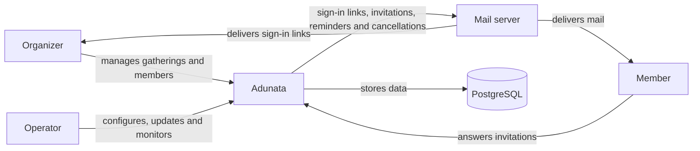

# Context and scope

## Business context

Adunata is one instance per ensemble. People use it through a browser. It sends mail through the ensemble's mail server and keeps its data in PostgreSQL.

|Partner|Sends to Adunata|Receives from Adunata|
|-|-|-|
|Organizer|Sign-in requests, members, gatherings, invitations and responses on a member's behalf|Sign-in links by mail, the member list and the overview of responses with totals and as a CSV file|
|Member|Responses through the personal link|Invitation, reminder and cancellation mail, the response page with the attendees and the calendar file of the gathering, which the calendar application of the member reads|
|Operator|Configuration and the start, update and stop of the service|Health status and logs|
|Mail server|Acceptance or rejection of each mail|Mail to deliver|
|PostgreSQL|Stored data|Queries and schema migrations|

## Technical context

|Partner|Channel|
|-|-|
|Organizer and member|HTTPS from a browser to a reverse proxy in front of Adunata, which listens on plain HTTP|
|Operator|Environment variables, an optional configuration file and secret files, the health endpoint `/api/health`, the command `adunata healthcheck`, JSON logs on standard output and the [exit status](../operating/installation.md#commands) of a failed start|
|Mail server|SMTP|
|PostgreSQL|The PostgreSQL protocol over a Unix socket or over TCP, with TLS as `sslmode` in the database URL sets, see [ADR 0020](../decisions/0020-tls-to-the-database-configured-in-its-url.md)|
