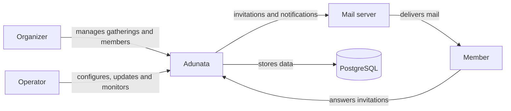

# Context and scope

## Business context

Adunata is one instance per ensemble. People use it through a browser. It sends mail through the ensemble's mail server and keeps its data in PostgreSQL.

|Partner|Sends to Adunata|Receives from Adunata|
|-|-|-|
|Organizer|Gatherings, members and invitations to send|Overviews of responses|
|Member|Responses to invitations|Invitation mail and the response form|
|Operator|Configuration and the start, update and stop of the service|Health status and logs|
|Mail server|Acceptance or rejection of each mail|Mail to deliver|
|PostgreSQL|Stored data|Queries and schema migrations|

Organizers and members appear here as they are planned. The foundation that exists so far serves only an example form.

## Technical context

|Partner|Channel|
|-|-|
|Organizer and member|HTTPS from a browser to a reverse proxy in front of Adunata, which listens on plain HTTP|
|Operator|Environment variables and secret files, the health endpoint `/api/health` and JSON logs on standard output|
|Mail server|SMTP|
|PostgreSQL|The PostgreSQL protocol over TCP or a Unix socket|
