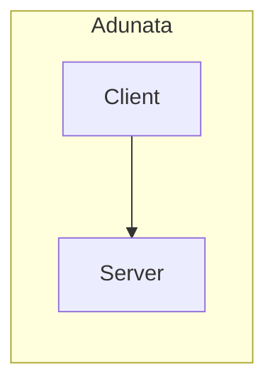
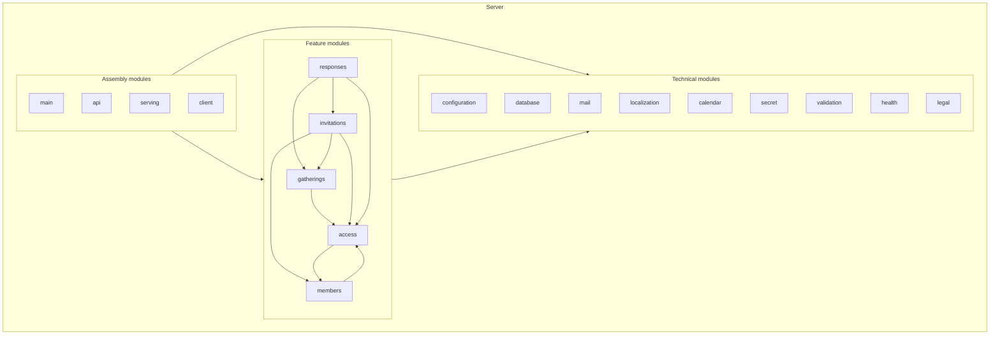
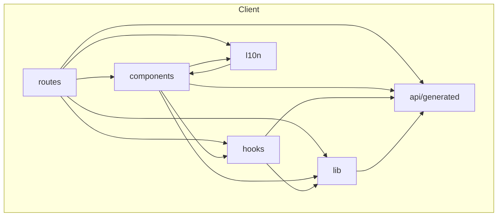

# Building block view

## Whitebox overall system

Adunata has two building blocks, the client and the server. The diagram shows them and their one dependency. In every diagram of this section a box inside another box is a part of it, and an arrow means that a block depends on the public interface of the block it points to. The diagrams show no data flow. The [runtime view](06-runtime-view.md) shows what the blocks exchange, and the [deployment view](07-deployment-view.md) shows where they run.

### Motivation

The split follows [ADR 0003](../decisions/0003-single-page-client-with-api.md). The client holds everything that people see and operate. The server holds every rule and all data. The client therefore decides nothing that the server does not check again. The client depends on the server, and the server knows nothing about the client except its built files, which it embeds.

### Contained building blocks

|Building block|Responsibility|Interface|
|-|-|-|
|Client|Renders the pages in the browser, validates forms and sends what people enter to the server.|The pages under the public URL.|
|Server|Checks and stores what the client sends, sends mail and serves the files of the client.|The API under `/api` and the commands of the binary, which the [installation guide](../operating/installation.md#commands) lists.|

### Important interfaces

The API is the only interface between client and server. The server describes it as one OpenAPI document, which the repository tracks as [`client/openapi.json`](../../client/openapi.json). The client calls the API only through code that is generated from this document. A contract test fails when the document, the server and the generated code differ.

## Level 2

### White box server

The server is a set of modules in one crate, see [ADR 0007](../decisions/0007-modular-monolith.md). The diagram shows the three kinds of modules and the dependencies between the feature modules. The table below lists every dependency, because the diagram draws the dependencies of the other two kinds once per group.

The server has three kinds of modules. A feature module owns one part of the domain with its routes, its rules and its tables. A technical module solves one problem for several other modules, such as mail or localization. An assembly module puts the others together into one router and one process.

The feature modules follow the things that the domain names, which are members, gatherings, invitations and responses, and `access` holds sign-in. `responses` depends on `invitations`, and `invitations` depends on `gatherings` and `members`. The modules `access` and `members` depend on each other, because a session belongs to a member and the member routes need a session. [ADR 0007](../decisions/0007-modular-monolith.md) restricts no direction.

Every module with routes takes the shared state of the server, such as the connection pool and the public URL, from `api`. The table does not repeat this dependency.

|Building block|Kind|Responsibility|Interface|Depends on|
|-|-|-|-|-|
|`main`|Assembly|Parses the command line, reads the configuration and starts the command that the operator chose.|The commands of the binary, which the [installation guide](../operating/installation.md#commands) lists.|`configuration`, `database`, `access`, `members`, `mail`, `responses`, `health`, `api`, `client`, `serving`|
|`api`|Assembly|Collects the routes of all modules into one router and one OpenAPI document and holds the shared state of the server.|The router, the OpenAPI document and the shared state.|every module with routes, `serving`, `configuration`|
|`serving`|Assembly|Accepts connections, sets the headers of every response and lets requests in progress finish when the process stops.|Functions that wrap a router and serve it until a termination signal arrives.|none|
|`client`|Assembly|Serves the files of the built client from the binary.|The router for all paths outside the API.|none|
|`access`|Feature|Signs organizers in, keeps their sessions and decides whether a request may change data.|The sign-in and session routes, the extractor `Organizer` and the layer for the `Origin` check.|`members`, `mail`, `localization`, `secret`, `configuration`|
|`members`|Feature|Keeps the member list with the organizer role.|The member routes and functions that read members.|`access`, `localization`, `validation`|
|`gatherings`|Feature|Keeps gatherings and decides from the date of the instance whether one is upcoming or past.|The gathering routes and functions that find a gathering.|`access`, `validation`|
|`invitations`|Feature|Keeps the invitations of members to gatherings with their personal links and queues the mail about a gathering.|The invitation routes and the extractor `PersonalLink`.|`gatherings`, `members`, `access`, `mail`, `calendar`, `localization`, `secret`, `validation`, `configuration`|
|`responses`|Feature|Stores the response to each invitation, serves the overview of a gathering and applies the retention periods.|The routes behind a personal link, the response and overview routes for organizers and the retention task.|`invitations`, `gatherings`, `access`, `calendar`, `localization`, `validation`, `configuration`|
|`configuration`|Technical|Reads and checks the settings of the instance.|The settings as one typed value.|`localization`|
|`database`|Technical|Opens the connection pool and applies pending migrations.|A connected pool and the exit status of a failed start.|none|
|`mail`|Technical|Stores mail in the outbox and delivers it in the background.|A function that adds a mail within a transaction and the delivery task.|`configuration`|
|`localization`|Technical|Holds one catalog per language and formats messages.|Functions that format messages and date ranges, and the catalog route.|none|
|`calendar`|Technical|Writes the calendar file of a gathering without I/O.|A function that turns a gathering into the text of the file.|`gatherings`|
|`secret`|Technical|Creates the secret of a link and its hash.|Functions that create a secret and hash a given one.|none|
|`validation`|Technical|Describes rejected fields the same way for every module.|The types of a field error and the response that carries them.|none|
|`health`|Technical|Reports whether the instance can serve requests.|The health route and the readiness check behind the command `healthcheck`.|none|
|`legal`|Technical|Exposes the addresses of the privacy notice and the imprint.|The route for the legal links.|none|

The compiler enforces the boundaries in Rust code, because a module reaches into another one only through what that module marks `pub`. It does not see SQL. The [data model](08-cross-cutting-concepts.md#data-model) says which module writes which table.

### White box client

The client is a single-page application, see [ADR 0003](../decisions/0003-single-page-client-with-api.md). The folders under [`client/src/`](../../client/src/) are its building blocks. The libraries behind them are in [ADR 0008](../decisions/0008-client-libraries.md).

|Building block|Responsibility|Interface|
|-|-|-|
|`routes`|Holds one folder per page with the code that only this page uses. A layout route guards the organizer pages.|The pages that the router shows for a path.|
|`components`|Holds the components that several pages share. The folder `ui` holds the copied shadcn components.|React components.|
|`hooks`|Holds the state that several pages share, such as the session of the organizer and the secret from the fragment of the URL.|React hooks.|
|`l10n`|Loads the catalog of the chosen language from the server and formats messages and dates.|A provider around the application and a function that translates a message.|
|`lib`|Holds helpers without a user interface, such as the query client and the reaction to an expired session.|Functions.|
|`api/generated`|Calls the API. Orval generates this code and the mocks for tests from the OpenAPI document of the server.|One function and one query hook per operation.|

Only `api/generated` depends on the API of the server. A change to the API therefore reaches the client as a change of generated code, and the contract test fails until both match.
