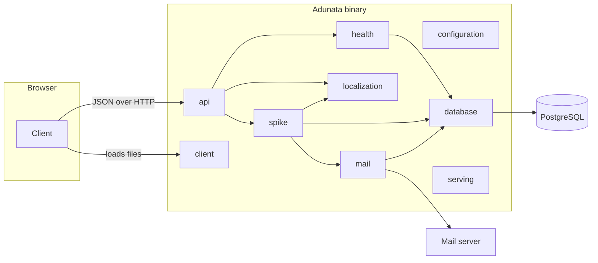

# Building block view

## Whitebox overall system

Adunata is one binary. The server modules answer API requests and serve the browser client, which the binary embeds. The client runs in the browser and talks to the server only through the API.

|Building block|Responsibility|Interface|
|-|-|-|
|Client|The single-page application in the browser. It renders pages, validates forms and shows text in the reader's language.|Calls the API. Loads its catalog from the server.|
|api|Collects the routes of all modules and describes them as one OpenAPI document.|The HTTP router and the OpenAPI document.|
|client|Serves the files of the built client from the binary. Paths without a file extension get the client's entry page.|The HTTP router for all paths outside the API.|
|configuration|Reads the settings of the instance from the environment.|The settings as one value.|
|database|Opens the connection pool and applies pending migrations. It refuses a schema that is newer than the binary.|A connected pool.|
|health|Reports whether the instance can serve requests and which dependency is unavailable.|The route `/api/health`.|
|localization|Holds one Fluent catalog per language, formats messages and serves catalogs to the client.|Formatting of messages and date ranges. The catalog route.|
|mail|Stores mail in the outbox and sends it in the background with retries.|Adding a mail within a transaction and running the delivery.|
|serving|Accepts connections and lets requests in progress finish when the service manager stops the process.|Serving the router until a termination signal arrives.|
|spike|An example form that exercises the stack from client to mail. Feature modules replace it.|The route for storing a response.|

The rules for module boundaries are in [ADR 0007](../decisions/0007-modular-monolith.md).
