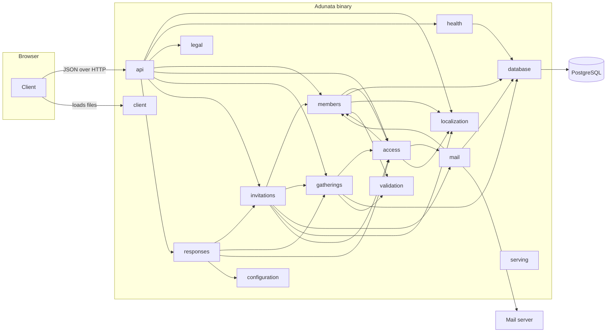

# Building block view

## Whitebox overall system

Adunata is one binary. The server modules answer API requests and serve the browser client, which the binary embeds. The client runs in the browser and talks to the server only through the API.

|Building block|Responsibility|Interface|
|-|-|-|
|Client|The single-page application in the browser. It renders pages, validates forms and shows text in the reader's language.|Calls the API. Loads its catalog from the server.|
|access|Signs organizers in by mail link, keeps their sessions, limits sign-in requests, checks the `Origin` of requests that change data, creates the first organizer and resolves the network address of a client behind trusted proxies.|The sign-in and session routes, the extractor `Organizer` for organizer routes, the layer for the `Origin` check, the function for the first organizer and, for local mode, the default first organizer and a sign-in link without mail.|
|api|Collects the routes of all modules and describes them as one OpenAPI document.|The HTTP router and the OpenAPI document.|
|client|Serves the files of the built client from the binary. Paths without a file extension get the client's entry page.|The HTTP router for all paths outside the API.|
|configuration|Reads the settings of the instance from the environment and an optional configuration file.|The settings as one value.|
|database|Opens the connection pool and applies pending migrations. It refuses a schema that is newer than the binary.|A connected pool.|
|gatherings|Keeps gatherings with title, location, description and span. It splits them into upcoming and past by the date in the time zone of the instance and refuses changes to a gathering that has ended. It depends on no other feature module.|The gathering routes and a function that finds a gathering for other modules.|
|health|Reports whether the instance can serve requests and which dependency is unavailable. Asks a running instance for its readiness.|The route `/api/health` and the readiness check behind the command `healthcheck`.|
|invitations|Invites members to gatherings, sends the invitation mail with the personal link, resends and revokes links and cancels a gathering together with the mail to every invited member.|The invitation routes, the cancellation route and the extractor `PersonalLink` that resolves the secret of a personal link for `responses`.|
|legal|Exposes the addresses of the privacy notice and the imprint that every page links.|The route `/api/legal-links`.|
|localization|Holds one Fluent catalog per language, formats messages and serves catalogs to the client.|Formatting of messages and date ranges. The catalog route.|
|mail|Stores mail in the outbox and sends it in the background with retries. While mail confinement is on, it sends every mail to the redirect address with the original recipient in `X-Original-To`.|Adding a mail within a transaction and running the delivery.|
|members|Keeps the member list with the organizer role. It refuses every change that would leave the instance without an active organizer, and deleting a member deletes everything that references the member.|The member routes and functions that other modules use to read members.|
|responses|Stores the response to each invitation with status, period of presence, beds and comment. It serves the response page of a member, the answers of organizers on a member's behalf and the overview with totals. Its hourly task applies the retention periods.|The routes behind a personal link, the response and overview routes for organizers and the retention task.|
|serving|Accepts connections and lets requests in progress finish when the service manager stops the process.|Serving the router until a termination signal arrives.|
|validation|Describes rejected fields the same way for every module.|The types of a field error and the response with status 422.|

The rules for module boundaries are in [ADR 0007](../decisions/0007-modular-monolith.md).
