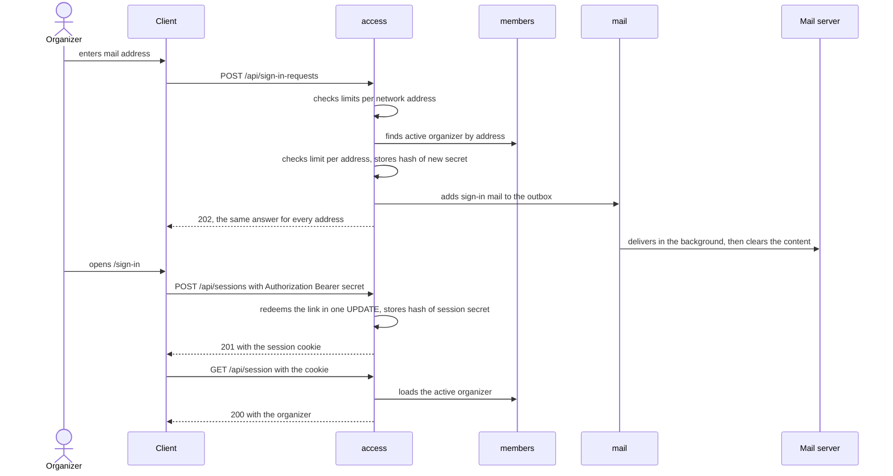
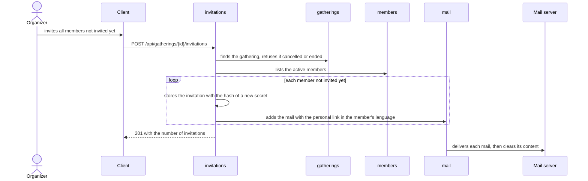
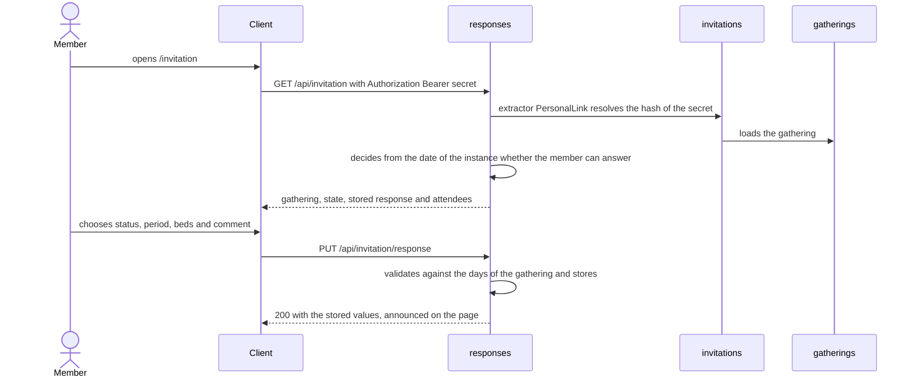
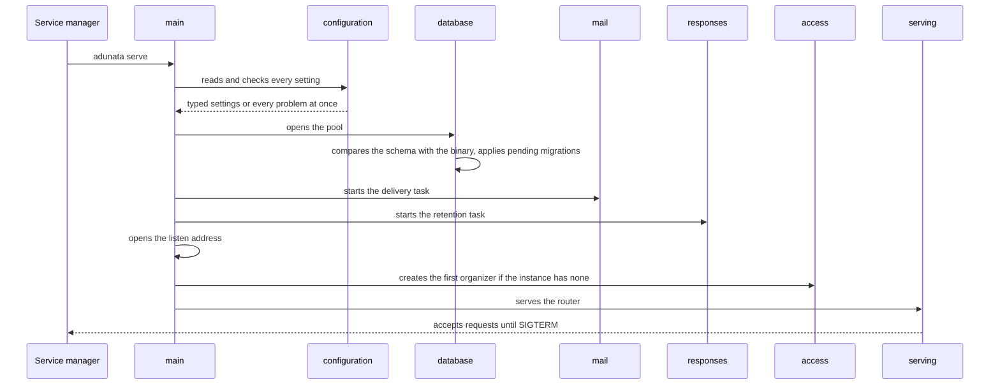
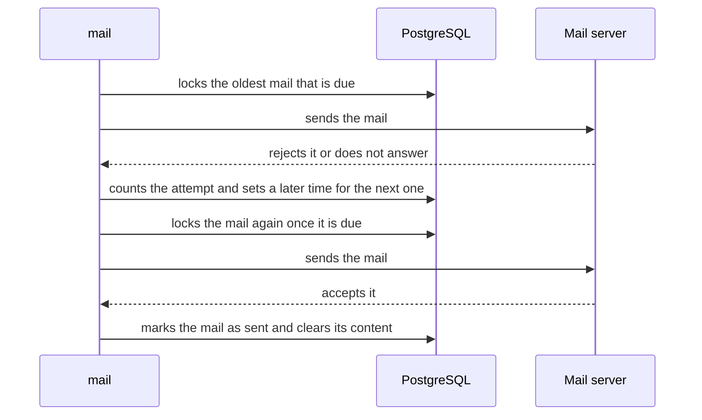

# Runtime view

## Sign-in

An organizer requests a sign-in link on a laptop and opens the mail on a phone or on the same laptop. The sequence shows the building blocks that take part, see [ADR 0010](../decisions/0010-sign-in-by-mail-link.md) for the reasons.

|Step|Building block|What happens|
|-|-|-|
|Request|`access`|Counts the request against the network address and then the links of the address in the last hour. Only for an active organizer within both limits it stores a link and queues its mail. The answer is always 202.|
|Delivery|`mail`|Sends the mail from the outbox with the organizer's name and clears its content once the mail server accepts it.|
|Confirmation|Client|Reads the secret from the fragment, which the browser never sends, and sends it only in the `Authorization` header when the organizer presses the button.|
|Redemption|`access`|Marks the link as used in the statement that finds it, so a second request fails. It starts a session for 14 days.|
|Every later request|`access`, `members`|The extractor for organizer routes loads the session with its member and rejects the request unless the member is still an active organizer.|

## Inviting members

An organizer invites the active members to a gathering. Mail leaves through the outbox, see [ADR 0006](../decisions/0006-outbox-for-mail.md), and loses its content once its delivery ends, see [ADR 0013](../decisions/0013-mail-loses-its-content-once-its-delivery-ends.md).

|Step|Building block|What happens|
|-|-|-|
|Check|`invitations`, `gatherings`|A cancelled or ended gathering takes no invitations.|
|Invite|`invitations`|One transaction stores every new invitation and its mail, so a failure leaves neither behind. A unique key per gathering and member skips members who are invited already.|
|Deliver|`mail`|Each mail goes out with the member's name and loses recipient, subject and bodies once the mail server accepts it or it fails for good. The list of invitations shows where the newest mail of each stands.|

## Answering through a personal link

A member opens the personal link from the invitation mail and answers. See [ADR 0011](../decisions/0011-personal-links-in-the-url-fragment.md) for why the secret stays in the fragment and [ADR 0012](../decisions/0012-wall-clock-times-in-the-instance-time-zone.md) for the times.

|Step|Building block|What happens|
|-|-|-|
|Open|`responses`, `invitations`|An unknown or revoked secret ends in status 404 that names nothing. Otherwise the page shows the gathering, the member's stored response and who comes.|
|State|`responses`, `gatherings`|`responses` derives the state of the page from the gathering and the date of the instance. The state decides whether the page offers a form. The [responses specification](../../openspec/specs/responses/spec.md) defines the states.|
|Store|`responses`|Validates the answer against the days of the gathering and stores it with a note that the member changed it last.|

## Start-up

The operator or the service manager runs `adunata serve`. The order matters, because each step fails before the next one causes an effect. The [installation guide](../operating/installation.md#commands) lists the exit statuses, see [ADR 0019](../decisions/0019-exit-statuses-from-sysexits-for-a-failed-start.md).

|Step|Building block|What happens|
|-|-|-|
|Configuration|`main`, `configuration`|An invalid configuration ends the start before Adunata touches the database or opens a port.|
|Database|`database`|A database that is unreachable or newer than the binary ends the start. Otherwise the pending migrations run before any other module uses the pool.|
|Background tasks|`mail`, `responses`|Both tasks run inside the process of the server, so an instance is one process.|
|Organizers|`access`|The first organizer exists before the first request arrives, so someone can sign in.|
|Serving|`serving`|On SIGTERM it stops accepting connections and lets requests in progress finish. Mail that waits stays in the outbox.|

## Delivering mail from the outbox

The delivery task of `mail` runs for as long as the process runs. The scenario shows a mail server that rejects the first attempt. See [ADR 0006](../decisions/0006-outbox-for-mail.md) for the outbox and [ADR 0013](../decisions/0013-mail-loses-its-content-once-its-delivery-ends.md) for the content.

|Step|Building block|What happens|
|-|-|-|
|Pick|`mail`|One transaction locks a due mail and skips mail that another transaction holds, so two deliveries never send the same mail.|
|Retry|`mail`|Each failed attempt moves the next one further away. After the configured number of attempts the mail fails for good and loses its content too.|
|Result|`mail`|The outbox keeps the row with its time of delivery or failure. `invitations` reads it to show where the mail of an invitation stands.|

The [mail delivery specification](../../openspec/specs/mail-delivery/spec.md) holds the requirements for retries. The [configuration reference](../operating/configuration.md#settings) names the setting for the number of attempts.
