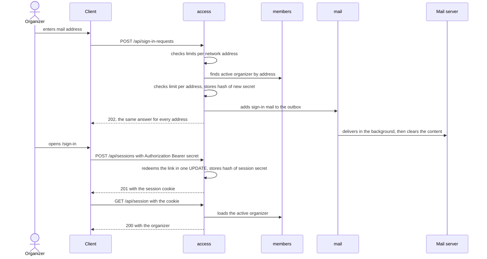
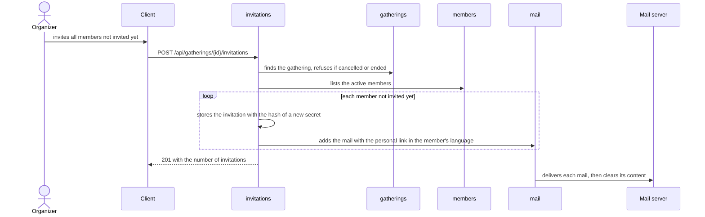
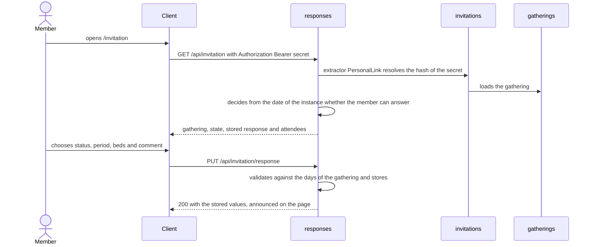

# Runtime view

## Sign-in

An organizer requests a sign-in link on a laptop and opens the mail on a phone or on the same laptop. The sequence shows the building blocks that take part, see [ADR 0010](../decisions/0010-sign-in-by-mail-link.md) for the reasons.

|Step|Building block|What happens|
|-|-|-|
|Request|`access`|Counts the request against the network address and then the links of the address in the last hour. Only for an active organizer within both limits it stores a link and queues its mail. The answer is always 202.|
|Delivery|`mail`|Sends the mail from the outbox with the organizer's name and clears its content once the mail server accepts it.|
|Confirmation|Client|Reads the secret from the fragment, which the browser never sends, and sends it only in the `Authorization` header when the organizer presses the button.|
|Redemption|`access`|Marks the link as used in the statement that finds it, so a second request fails. It starts a session for 14 days.|
|Every later request|`access`, `members`|The extractor for organizer routes loads the session with its member and rejects the request unless the member is still an active organizer.|

## Inviting members

An organizer invites the active members to a gathering. Mail leaves through the outbox, see [ADR 0006](../decisions/0006-outbox-for-mail.md), and loses its content once its delivery ends, see [ADR 0013](../decisions/0013-mail-loses-its-content-once-its-delivery-ends.md).

|Step|Building block|What happens|
|-|-|-|
|Check|`invitations`, `gatherings`|A cancelled or ended gathering takes no invitations.|
|Invite|`invitations`|One transaction stores every new invitation and its mail, so a failure leaves neither behind. A unique key per gathering and member skips members who are invited already.|
|Deliver|`mail`|Each mail goes out with the member's name and loses recipient, subject and bodies once the mail server accepts it or it fails for good. The list of invitations shows where the newest mail of each stands.|

## Answering through a personal link

A member opens the personal link from the invitation mail and answers. See [ADR 0011](../decisions/0011-personal-links-in-the-url-fragment.md) for why the secret stays in the fragment and [ADR 0012](../decisions/0012-wall-clock-times-in-the-instance-time-zone.md) for the times.

|Step|Building block|What happens|
|-|-|-|
|Open|`responses`, `invitations`|An unknown or revoked secret ends in status 404 that names nothing. Otherwise the page shows the gathering, the member's stored response and who comes.|
|State|`responses`, `gatherings`|Before the first day the member answers. From the first day the page shows the response without a form, after the last day also without attendees, and a cancelled gathering takes no answer.|
|Store|`responses`|Times are wall-clock times of the instance in steps of 30 minutes within the days of the gathering. A decline clears period and beds. The row records that the member changed it last.|
