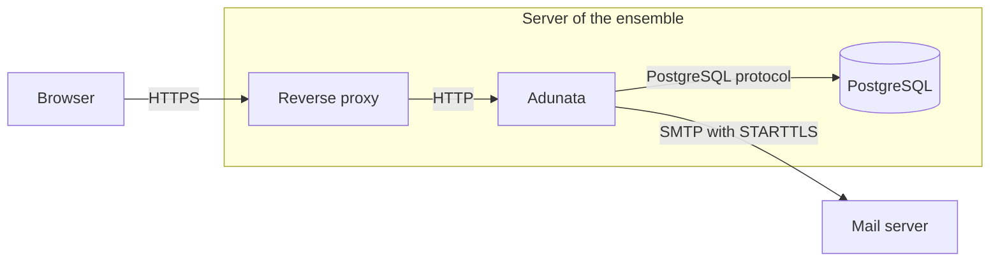

# Deployment view

Every deployment has the same parts. A reverse proxy terminates HTTPS and forwards to Adunata. Adunata talks to PostgreSQL and to the ensemble's mail server. Only the way Adunata itself runs differs. The [installation guide](../operating/installation.md) describes the steps for operators.

|Element|Description|
|-|-|
|Browser|Loads the client from Adunata and calls its API through the proxy.|
|Reverse proxy|Terminates HTTPS, for example Caddy or nginx. Adunata itself listens on plain HTTP, by default on `127.0.0.1:8080`.|
|Adunata|One process that serves the client and the API and sends mail in the background.|
|PostgreSQL|Holds all data. Often on the same host, reached through its Unix socket.|
|Mail server|The ensemble's existing mail server or hosting account.|

## Ways to run Adunata

|Way|Artifact|How it runs|
|-|-|-|
|NixOS|The module `nixosModules.default` of the flake|A systemd service with a dynamic user and a hardened sandbox. It can create a local database and connects to it through the Unix socket. Passwords arrive as systemd credentials.|
|Container|The OCI image `ghcr.io/kammerchor-wernigerode/adunata`|An unprivileged process listening on port 8080, configured through environment variables and secret files.|
|Other Linux distributions|The release archive with a statically linked binary|The example systemd unit with the same sandbox as on NixOS. Settings come from `/etc/adunata/adunata.env` and passwords from credential files.|

The flake builds all three from the same source, see [ADR 0005](../decisions/0005-nix-flake-as-build-definition.md). The image and the release archive carry the same statically linked binary. The NixOS module runs a build against the libraries of nixpkgs.
