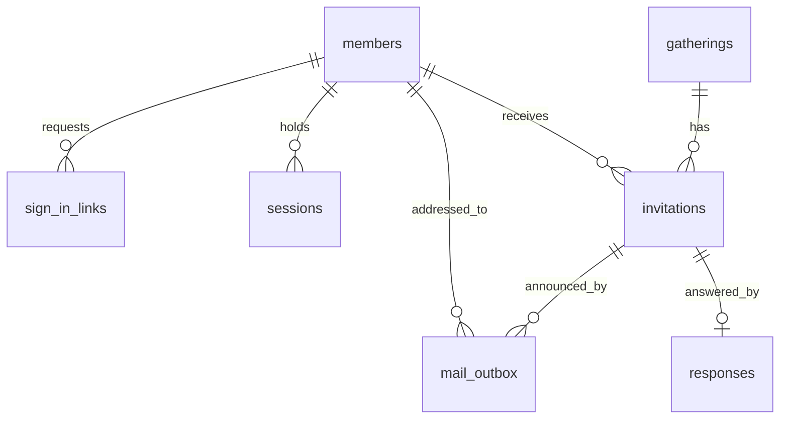

# Cross-cutting concepts

## Data model

Each table has one module that writes it. Three modules also read tables of other modules in a join. `mail` reads `members`. `invitations` reads `members`, `responses` and `mail_outbox`. `responses` reads `gatherings`, `invitations` and `members`. No decision covers this yet, see [risks and technical debt](11-risks-and-technical-debt.md).

The diagram shows the tables and how their rows depend on each other.

|Table|Written by|Holds|
|-|-|-|
|`members`|`members`|The people of the ensemble with their language and the organizer role.|
|`sign_in_links`|`access`|The hash of each sign-in link with its expiry.|
|`sessions`|`access`|The hash of each session secret with its expiry.|
|`gatherings`|`gatherings`|The gatherings with their days and a counter of changes.|
|`invitations`|`invitations`|One row per member and gathering with the hash of the personal link.|
|`responses`|`responses`|At most one response per invitation.|
|`mail_outbox`|`mail`|Each mail until its delivery ends, then only the result.|

Every relation in the diagram is a foreign key that deletes the dependent rows with their parent. Deleting a member or a gathering removes everything that refers to it. No module has to know which other modules store data about it. The database also holds the rules that must never break, such as the allowed values of a status, as constraints.

## Configuration

An instance takes its configuration from environment variables and from an optional configuration file in TOML, which the operator names with `--config` or `ADNT_CONFIG_FILE`. The file groups the settings in fixed tables by concern, and each variable derives from table and key. A setting in the environment wins over the same setting in the file. Each secret comes either as a plain value or from a file that a setting names. The file form fits secret handling in NixOS, Docker and systemd alike. One source must not set both forms of a secret.

A development build reads further files, which the [contributing guide](../../CONTRIBUTING.md#settings) describes. A release build never reads them.

The module `configuration` reads all settings at start-up and checks them together. It collects every problem before Adunata touches the database or opens a port, so an operator fixes all mistakes in one round. Each message names the setting and never a secret value. A message about the configuration file names the file and the key but never a value or the content of a line. Other modules receive typed settings, such as the public base URL, and never read the environment or the file themselves. The exceptions are `SSL_CERT_FILE` and `SSL_CERT_DIR`, which the TLS library of mail delivery and of the database connection reads to find the trust store, as every TLS tool on the host does. The module `configuration` does not check them. It checks the parameters of the database URL before sqlx parses it, because sqlx logs an unknown parameter with its value. It rejects every variable whose name starts with `PGSSL`, because sqlx would read some of them besides the URL.

A setting that is a switch, such as `mail.confine`, takes a boolean in the file and `true` or `false` in the environment. The settings `mail.confine` and `mail.confine-to` belong to `serve --dev`, see [ADR 0024](../decisions/0024-mail-confinement-behind-serve-dev.md). The module `configuration` reads them for every command, and `serve` without `--dev` refuses to start when either is present.

The settings and their defaults are listed in the [configuration reference](../operating/configuration.md).

## Localization

Every text that people read comes from a Fluent catalog per language in [`server/locales/`](../../server/locales/). The server formats mail with these catalogs and serves the same files to the client at `/api/catalogs/{language}`, so each text exists once for both. Fluent applies the plural rules of each language.

English is the fallback. When a catalog lacks a text, the English text appears instead of a key. The client loads the English catalog next to the chosen one for this purpose.

The client starts in the language the browser prefers among German and English. A signed-in organizer changes it in the account menu, everyone else in a select in the header. The choice stays on the device. The document language follows the choice, so screen readers pronounce text correctly.

Mail goes out in the language stored for the member who receives it. The default language of the instance applies to the first organizer and to members that `grant-organizer` creates. The client formats dates with the browser's own date formatting. The server spells out date ranges in mail through the catalog, because Fluent in Rust has no date formatting.

## Authentication and authorization

Members never sign in. They reach their invitation through a personal link. Organizers sign in with a single-use link by mail, see [ADR 0010](../decisions/0010-sign-in-by-mail-link.md) and the [runtime view](06-runtime-view.md#sign-in).

The module `access` owns sign-in, sessions and the first organizer. Other modules protect a route by taking the extractor `Organizer` as an argument. It loads the session from the cookie with its member and answers with status 401 unless the member is active and holds the organizer role. Revoking the role or deactivating a member therefore ends every session at the next request. The client sends a visitor without a session to the sign-in page.

Local mode for debug runs weakens these rules on `localhost` only, see [ADR 0023](../decisions/0023-local-mode-on-localhost.md) and the [local mode specification](../../openspec/specs/local-mode/spec.md).

An integration test in [`server/src/api.rs`](../../server/src/api.rs) calls every operation of the OpenAPI document without a session and expects status 401. Only health, catalogs, the legal links, sign-in and sign-out and the routes behind an invitation link are exempt. A new route that forgets the extractor fails this test.

`access` limits sign-in requests to three links per hour per address and 20 requests per hour per network address. Behind a trusted proxy the network address is the rightmost entry of `X-Forwarded-For` that is no trusted proxy.

## Personal links

Invitation links and sign-in links follow one rule, see [ADR 0011](../decisions/0011-personal-links-in-the-url-fragment.md). Each carries a random secret of 256 bits in the fragment, such as `/invitation#3f9a…`. The module `secret` creates it and its SHA-256 hash, and only the hash reaches the database. The client reads the fragment and sends the secret only in the header `Authorization: Bearer <secret>`.

The module `invitations` resolves the secret of an invitation through the extractor `PersonalLink`, which the routes of `responses` take as an argument. An unknown or revoked secret fails with status 404 and reveals no gathering or member. Resending and reminding both store the hash of a new secret in place of the old one.

## Retention of personal data

Personal data expires by default. Once per hour a task of the module `responses` applies two periods that count from the last day of a gathering. After the first period it clears the comments of the gathering's responses. After the second period it deletes the gathering's invitations, and their responses go along through the foreign key. The gathering itself stays, so organizers see a past gathering without invitations. The [configuration reference](../operating/configuration.md#settings) names both settings and their defaults. The same task deletes ended sessions and sign-in links that are used or expired.

Each module deletes its own rows through a public function, so `responses` asks `invitations` and `access` to do so. Deleting a member deletes the member's invitations, responses, sessions, sign-in links and waiting mail through foreign keys. Mail loses its content once its delivery ends, see [mail delivery](#mail-delivery).

A CSV file of the overview that an organizer downloads lies outside these periods, because Adunata cannot delete it. The overview says so next to the download link.

## Time

The days of a gathering are dates. Times of arrival and departure are wall-clock times without an offset, such as `2027-03-14T18:00`. The database, the API, the client and mail carry them unchanged, so every view shows the same time. [ADR 0012](../decisions/0012-wall-clock-times-in-the-instance-time-zone.md) records why.

The required setting `ADNT_LOCALIZATION_TIME_ZONE` names the time zone of the instance. One function in the module `configuration` turns an instant into the date and wall-clock time of the instance. Every comparison with the present goes through it, such as whether a gathering has begun or whether its deadline for responses has passed. The calendars of the client may use the date of the browser to disable days, but only the server decides whether a day lies in the past. Instants such as the end of a session stay `timestamptz` in the database and pass through the same function before they reach the API or a mail. The binary embeds the time zone database, so hosts and images need no zone files.

## Calendar file

A calendar keeps the entry of a gathering across downloads, so the file must name the same entry every time and say when it is newer. [ADR 0025](../decisions/0025-stable-calendar-uids-for-gatherings.md) defines both. The [responses specification](../../openspec/specs/responses/spec.md) defines who gets the file and what it holds.

## Security headers

One layer around the whole router sets these headers on every response, whether it comes from the API or serves the client:

|Header|Value|Effect|
|-|-|-|
|`Referrer-Policy`|`no-referrer`|Sites that a page links to never learn its address.|
|`Content-Security-Policy`|`default-src 'self'; frame-ancestors 'none'`|Pages load scripts, styles, fonts and data from Adunata only and no other site can frame them.|
|`X-Content-Type-Options`|`nosniff`|Browsers trust the declared content type.|

Every API response also carries `Cache-Control: no-store`, so no cache keeps personal data. The client must therefore ship every script and style as a file and set styles only through the DOM, never as an inline element.

A middleware on `/api` rejects every request with a method other than `GET` or `HEAD` whose `Origin` header differs from the origin of `ADNT_HTTP_PUBLIC_URL`. A page on another origin can therefore not change data through the browser of a signed-in organizer. A request without `Origin` does not come from a browser page and passes.

## Validation and error handling

The server checks every value again, whatever the client checked before. A handler answers a rejected value with status 422 and a list of field errors from the module `validation`. Each error names the field and a code, never a text. The client turns the code into a message from the catalog and shows it at the field, so the text of an error lives in the catalog like every other text.

Other failures answer with a status and no field errors. A missing session ends in status 401, a request from another origin in 403, an unknown or revoked link in 404 and a failure of the database in 500. The client sends a visitor whose session ended to the sign-in page.

## User interface

The client builds on the components and libraries of [ADR 0008](../decisions/0008-client-libraries.md). These rules hold for every page. The specifications describe what each page shows.

|Rule|Reason|
|-|-|
|Components use only the semantic tokens of shadcn/ui and never a fixed color. The brand color enters through the primary token alone.|Branding per instance can later set one token.|
|The boundary of a control and the focus indicator reach a contrast of at least 3:1 against their background in both color schemes.|WCAG 2.2 asks for it.|
|The client follows the color scheme of the operating system.|People keep the scheme they chose.|
|Sizes are in `rem`.|The interface scales with the text size of the browser.|
|The binary serves the fonts with their licenses.|The Content Security Policy allows no other origin, see [security headers](#security-headers).|
|A state such as a chosen option or a status shows through shape or text and never through color alone.|People who do not see the color still read the state.|
|Every route sets its page title through the main heading. Focus moves there after a route change.|A screen reader announces the new page.|
|A field with an error carries `aria-invalid` and links its message through `aria-describedby`. After a rejected save, focus moves to the first invalid field.|People find the error without sight.|
|A successful save is announced through an element with `role="status"`.|A screen reader reports the result.|

The [testing concept](#testing) says which level of tests checks these rules.

## Persistence and migrations

PostgreSQL holds all data, see [ADR 0004](../decisions/0004-postgresql-as-database.md). Queries are plain SQL that the server sends at runtime. Builds therefore need no database.

The connection to PostgreSQL takes its TLS settings from the database URL, see [ADR 0020](../decisions/0020-tls-to-the-database-configured-in-its-url.md). Only `verify-ca` and `verify-full` check the certificate of the database, against the trust store of the host as for the [mail server](#mail-delivery). The [configuration reference](../operating/configuration.md#settings) describes the modes.

The binary embeds its migrations. On start, the module `database` compares the newest migration applied to the database with the newest one the binary knows. If the database is ahead, a newer release has already migrated it. Adunata then refuses to start without changing anything and exits with a status that the [operating guide](../operating/installation.md#commands) lists. Otherwise it applies the pending migrations before it accepts requests. Migrations only move forward, and a released migration never changes. Going back to an older release means restoring a backup.

Waiting for a database connection is capped at five seconds, so a lost database shows up quickly in the health status.

## Process model

An instance is one process. The delivery of mail and the retention task run as background tasks inside it. The limit of sign-in requests per network address lives in its memory. The process keeps no other state, so a restart loses only that limit. Everything else is in PostgreSQL.

## Logging

Adunata writes one JSON object per line to standard output and leaves collecting and storing logs to the platform, such as the journal or a container runtime.

Logs carry no personal data and no secrets. In particular they never contain:

- secrets or values of the configuration, which therefore never go to a log as a whole
- invitation links or other links that grant access
- recipients, subjects or bodies of mail
- the text of a mail server's reply, which often repeats the recipient

An event instead names what happened and the identifiers an operator needs to look further, such as the id of an outbox entry. Requests are not logged. Personal links never reach a request line anyway, because their secret sits in the fragment of the URL, see [personal links](#personal-links).

Local mode on `localhost` is the one exception. It logs sign-in links on purpose, see [authentication and authorization](#authentication-and-authorization).

## Mail delivery

Every mail goes through the outbox, see [ADR 0006](../decisions/0006-outbox-for-mail.md). A module that causes a mail adds it to the outbox within its own transaction and never talks to the mail server itself. Each mail has a plain text part and an HTML part with the same content and the same links, so it reads completely in any mail client. A mail about a gathering also carries its calendar file as the attachment `gathering.ics`, see [ADR 0026](../decisions/0026-calendar-file-attached-to-mails-about-a-gathering.md).

The connection to the mail server is encrypted with STARTTLS unless the operator chooses implicit TLS or, explicitly, no encryption. Adunata checks the server certificate against the certificate authorities in the trust store of the host, see [ADR 0016](../decisions/0016-trust-store-of-the-host-for-mail-server-certificates.md). The [configuration reference](../operating/configuration.md#certificate-authorities) names the store each way of running Adunata uses.

A failed delivery is logged with the outbox entry and the kind of failure, as [logging](#logging) describes. Mail that failed for good stays in the outbox with its failure time.

A mail loses its recipient, subject, both bodies and its calendar file in the statement that marks it as sent or as failed for good, see [ADR 0013](../decisions/0013-mail-loses-its-content-once-its-delivery-ends.md). Personal links therefore stay in the database only while their mail waits. The outbox stores the bare address and references the member and, for an invitation mail, the invitation. Delivery adds the member's name to the address.

Every value that organizers or members entered, such as titles, locations and names, passes through the function `escape_html` of the module `mail` before it goes into an HTML part.

## Health

The endpoint `/api/health` reports whether the instance can serve requests and, if not, which dependency is unavailable. It carries no personal data and no configuration values, so monitors may call it without authentication.

The command `adunata healthcheck` asks the same endpoint from inside a container, because the image has no shell and no HTTP client, see [ADR 0022](../decisions/0022-healthcheck-as-a-command-of-the-binary.md). The [operating guide](../operating/installation.md#check-readiness) describes the command and how an operator wires it.

## Shutdown

On SIGTERM, Adunata stops accepting connections, lets requests in progress finish and exits with status zero. Mail that the background task has not yet sent stays in the outbox and goes out after the next start.

## Testing

Tests run at several levels. Each level checks what the level below cannot see.

|Level|What it proves|Example|
|-|-|-|
|Unit|Logic without any input or output is correct, such as the formatting of a message.|`plural_forms_in_german` in [`server/src/localization.rs`](../../server/src/localization.rs)|
|Server integration|An API handler works with real routing against a real PostgreSQL and a real mail server for tests. Each test gets its own empty database with all migrations applied.|`duplicate_address` in [`server/src/members.rs`](../../server/src/members.rs)|
|Client integration|A page works when someone drives it like a user, against mocks that Orval generates from the OpenAPI document. Each page passes the accessibility checks of axe.|[`client/src/routes/_organizer/members/members.integration.test.tsx`](../../client/src/routes/_organizer/members/members.integration.test.tsx)|
|Contract|The tracked OpenAPI document matches the server. The generated client code matches the document.|`the_client_holds_the_current_document` in [`server/src/api.rs`](../../server/src/api.rs)|
|End to end|A few complete flows work in a browser against the real binary, PostgreSQL and a mail server for tests. This level checks what needs computed colors and a layout, which are contrast, both color schemes and reflow on a narrow screen with enlarged text.|[`client/e2e/invitation.e2e.ts`](../../client/e2e/invitation.e2e.ts)|
|Installation|Each supported way to run Adunata starts in a virtual machine, migrates the database, reports healthy and serves the client.|[`nix/test.nix`](../../nix/test.nix)|

A unit test has no input or output. It uses no database, no mail server, no socket, no file and no router. Every other test is an integration test. On the server it lives in a module named `integration`, on the client in a file named `*.integration.test.ts` or `*.integration.test.tsx`.

The same checks run on a laptop and in CI, see [ADR 0005](../decisions/0005-nix-flake-as-build-definition.md). The end-to-end tests are the exception and run outside the flake. The [contributing guide](../../CONTRIBUTING.md#checks-before-a-push) describes how to run each level. [Continuous integration](../maintenance/ci.md) describes the jobs. The installation tests do not run on `aarch64`, see [risks and technical debt](11-risks-and-technical-debt.md).
