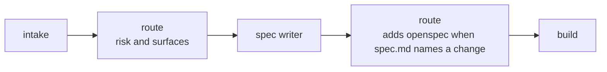

# Design

## Context

See proposal.md for the motivation. These facts of the current code shape the approach.

- `factory/bin/route` runs in the intake step, right after intake accepts the issue. It builds the reviewer set from `routing` and `surface_reviewers` in `factory/config.json` and stores it with `factory/bin/job agents`. `job agents` refuses every stage but `intake`. `job advance <id> spec` refuses a job that has no reviewer set.
- `spec.md` appears one step later, in the stage `spec`. The job's worktree exists from the move to that stage on. The spec writer puts a line `CHANGE: <name>` or `CHANGE: none` into it, after the title and the quoted issue. `header()` in `factory/bin/job` stops at the first blank line, so it never reaches that line.
- The orchestrator starts every key of `agents.reviewers` as the role `reviewer-<key>` with the model from the same map. `factory/bin/job` expects `round-<N>/review-<key>.md` with `VERDICT: PASS` or `VERDICT: CHANGES` as its first line. Neither needs to know a reviewer by name.
- `reviewer-code.md` holds the OpenSpec checks in one bullet of "What to look for". Its description and its rule for `CHANGES` mention them too.
- Commit `1fe4b74` switched the profile to `core`. It deleted `.agents/skills/openspec-verify-change/SKILL.md` and the link `.claude/skills/openspec-verify-change`. It also rewrote `openspec/README.md`. With the profile `custom` and the workflow `verify`, `openspec update --dry-run` reports exactly those two paths as additions.
- The skill `openspec-verify-change` is written for a person in a chat. It asks which change to verify when none is named, calls its report advisory and sorts issues into CRITICAL, WARNING and SUGGESTION. It marks a check "Not verified" when it lacks the evidence and "Not applicable" when the change leaves the artifact out on purpose. Its completeness check counts the checkboxes of `tasks.md`. It does not compare a ticked task with the diff. It does not run `openspec validate` and does not look at the history of the artifacts.
- The files under `factory/`, `.claude/agents/` and `.agents/skills/factory/` match `protected_paths`. The gate fails a job branch that changes one, so a person builds this change by hand.
- The builder writes a `build.md` with `STATUS: BLOCKED` when an artifact is wrong and no `feedback-*.md` asks for an edit. The job then goes to `needs-human`.
- The approver refuses a round in which a Note of a review describes a real problem.
- The change `review-before-publish` merges before this one. It adds the stages `publish` and `remote` and the file `round-<N>/review-remote.md`, raises `max_rounds` to 5, lets `reviewer-code` judge the replies to CodeRabbit and removes the Stop hook of the builder. After a remote `CHANGES` every local reviewer runs again.

## Goals / Non-Goals

**Goals:**

- One reviewer owns every check of the code against the OpenSpec change. Each check of today's `reviewer-code` has a home in the skill or in the agent file. The skill alone would lose three of them, which decision 4 adds.
- A job without a change costs nothing more than today.
- A forgotten routing call stops the job at the next `advance` instead of running a review round with the wrong reviewers.
- An unknown risk or surface still stops a job before the spec writer runs. That holds for a risk that `change_reviewers` lacks too.

**Non-Goals:**

- The approver stays as it is, including its own look at the tasks and the delta specs.
- The flow of the factory after the review is the one that `review-before-publish` leaves. This change adds a reviewer to it and changes no stage.
- The rule for a group "Hand-over" that commit `1fe4b74` removed from `openspec/config.yaml` stays removed. The factory still pushes and opens the pull request itself.
- No test framework for the scripts of the factory. The tasks check the routing by hand.

## Decisions

None of the decisions below is architecturally significant. Each one changes only the development tooling, so no operator and no running instance notices it. The change drafts no decision record.

No section of `docs/arc42/` is affected. The architecture documentation does not describe the factory, its reviewers or the OpenSpec profile.

### 1. Run `route` twice, after intake and after the spec step

The orchestrator runs the same script `factory/bin/route` at two places. The first run stays where it is, after intake accepts the issue. The second run comes after the spec writer returns and before `job advance <id> build`. There is no second script.

The diagram shows where the two runs sit between the steps of a job.

`route` is deterministic and replaces the whole reviewer set through `job agents`. The first run sees no `spec.md` and yields the set of risk and surfaces, as today. It still rejects an unknown risk or surface before the spec writer runs. It looks up the risk in `change_reviewers` too, as decision 2 describes. The second run yields the same set and adds `openspec` when `spec.md` names a change. A resumed spec step runs the spec writer and then `route` again, which gives the same result.

`factory/bin/job` changes in two places. `job agents` accepts the stages `intake` and `spec`. It stores the stage of the call in the reviewer set as `agents.routed`. The transition `spec → build` requires `agents.routed` to be `spec` and names `factory/bin/route` in its refusal. A forgotten second run then stops the job at `advance` instead of skipping the review of the change without a trace. The transition `intake → spec` keeps its check for a reviewer set. After the second run, `job advance <id> build` succeeds. A first run in the stage `intake` followed by `job advance <id> spec` works as before.

Alternatives:

- Route once, after the spec step. That needs one call less, but an unknown risk or surface would surface only after the run of the spec writer.
- Run `route` twice without the check in `advance`. A forgotten second run would leave the old set in place. The job would then pass its review without `reviewer-openspec`.
- Let `job advance <id> build` add the reviewer. That splits the routing between two scripts and hides a part of it from `config.json`.
- Let intake predict whether the job becomes a change. The spec writer makes that call. A wrong prediction skips the review or wastes one.

Not architecturally significant: the order of steps in a development tool.

### 2. `route` reads the `CHANGE:` line and `config.json` names the model per risk

`factory/config.json` gets a table `change_reviewers` next to `routing`, keyed by risk like `routing`:

|Risk|Entry|
|-|-|
|`low`|`{ "openspec": "haiku" }`|
|`medium`|`{ "openspec": "sonnet" }`|
|`high`|`{ "openspec": "sonnet" }`|

The models follow those of `reviewer-code` in `routing`. The gain of this change is a reviewer with one job and a verdict of its own, not a stronger model. Task 3.6 tries the reviewer once on Haiku. If Haiku fails that trial, the entry for `low` becomes `sonnet`.

The shape equals that of `routing`, so `route` merges the entry of the job's risk into the reviewer set as it merges the entries of the surfaces. `route` looks up the risk in `change_reviewers` in both runs. A risk that the table lacks ends `route` with an error, so the job stops before the spec writer runs. Only the run in the stage `spec` uses the entry.

In the stage `intake`, `route` does not look for `spec.md`. In the stage `spec`, it takes the first line of `spec.md` that matches `^CHANGE:[ \t]*(\S+)[ \t]*$`. Later lines that match do not count. The value `none` means that the job has no change and adds nothing. Every other value is the name of the change and adds the entry of the job's risk. A missing `spec.md` ends `route` with an error. So does a `spec.md` without a matching line, which includes a line `CHANGE:` with an empty value. The spec writer always writes the line, so the error keeps a malformed `spec.md` from skipping the review without a trace.

When `route` adds `openspec`, it checks that `.agents/skills/openspec-verify-change/SKILL.md` exists in the job's worktree, whose path `job.json` holds. A missing file ends `route` with an error that names the path. The job then stops at the spec step instead of starting a reviewer that has nothing to follow.

Alternatives:

- One model for every risk. The other reviewers of a job follow its risk. This one would not.
- Extend `header()` to read past blank lines. Every other caller relies on it stopping there.
- Check whether `openspec/changes/<name>/` exists on the branch. `spec.md` is the contract between spec writer and factory. The folder also exists for changes of other jobs that are merged but not archived.

Not architecturally significant: a key in the configuration of a development tool.

### 3. The key is `openspec` everywhere

The reviewer set uses the key `openspec`. That gives the role `reviewer-openspec`, the file `round-<N>/review-openspec.md` and the entry `review-openspec` in `ROUND_ORDER` of the dashboard, placed after `review-code`. On top of `review-before-publish` the list then reads `checks`, `review-code`, `review-openspec`, `review-security`, `review-ux`, `review-ui`, `review-remote`, `merge-checks`, `ci`. Those are nine names, and `fileRank` allows ten. The chip reads `ospec`, because `spec` is already the name of a column. `factory/bin/job` needs no entry, since it derives role and file from the key.

Not architecturally significant: names inside a development tool.

### 4. `reviewer-openspec` follows the skill and adds three checks

The agent file gives the reviewer the same frame as the other lenses: the worktree rules, the section "Checks are done", the previous review from round 2 on and the format of the review file. It takes "Checks are done" word for word from `reviewer-code.md` as that file reads after `review-before-publish`, so it claims no check that the gate of that change does not run.

Its work is the skill. It reads `.agents/skills/openspec-verify-change/SKILL.md` in the job's worktree and follows it for the change that `spec.md` names. The worktree starts from a fresh `origin/main`, while the main checkout often lags behind it. The skill's steps that ask a person do not apply. The reviewer never prompts and never picks another change. The skill's report goes into `review-openspec.md` instead of the chat. The scorecard goes under Notes. Each CRITICAL, each WARNING and each check marked "Not verified" becomes a numbered finding, as decision 5 describes.

The reviewer runs three checks that the skill lacks and that `reviewer-code` does today:

- For each ticked task of `tasks.md`, the diff of the branch shows the work that the task describes. The skill only counts checkboxes, so a task that is ticked and not done would pass it.
- `openspec validate <name>` passes.
- The proposal, the design, the delta specs and `tasks.md` are unchanged since the spec writer's commit, apart from ticked checkboxes and edits that a `feedback-*.md` asks for. A task that is deleted or reworded counts as a change, because the skill and the check above see only the tasks that remain. The reviewer checks those edits against the feedback.

A `feedback-*.md` still wins over the change where they disagree, as for every other agent of the factory.

The agent reads the skill file instead of loading it through a skill tool, as the spec writer and the builder already do with their skills. That works in every coding agent that runs the factory.

Alternatives:

- Copy the checks of the skill into the agent file. The copy would drift from the skill with every `openspec update`.
- Leave `openspec validate` and the unchanged artifacts with `reviewer-code`. Both concern the change and not the code. `reviewer-code` would still have to read the change's history.
- Read the skill from the main checkout. A job that changes the skill would then be judged with the old one, but every job would be judged with a stale skill whenever the main checkout lags.

Not architecturally significant: the instructions of a review agent.

### 5. CRITICAL, WARNING and "Not verified" are `CHANGES`, a SUGGESTION is a note

The skill calls itself advisory. In the factory its result is binding. A CRITICAL and a WARNING each make the verdict `VERDICT: CHANGES`. A check that the skill marks "Not verified" does too, with its reason as the finding, because a check that did not run has not passed. A failed check of decision 4 is a finding as well: a ticked task without its work in the diff, a failed `openspec validate` and an artifact edit without feedback.

Some checks stay "Not verified" until an artifact changes, for example a scenario that names no observable result. The builder may not edit an artifact without feedback. The reviewer therefore says in such a finding that only an edit of the artifact can fix it and names the artifact. The builder then writes a `build.md` with `STATUS: BLOCKED` in that round, which hands the job to a person at once.

A SUGGESTION goes under Notes and does not block. The approver reads the Notes of every review and refuses a round whose Notes describe a real problem. "Not applicable" is neither a finding nor a note. Other observations go under Notes too. Without a finding the verdict is `VERDICT: PASS`.

One alternative lets a SUGGESTION block as well. It is rejected because a SUGGESTION of the skill is a matter of taste, such as a code pattern, and would cost a round each time.

Not architecturally significant: the verdict rule of a review agent.

### 6. `reviewer-code` keeps the change as its spec and drops the checks of it

`reviewer-code.md` changes in three places. The edit lands on the file as `review-before-publish` leaves it, so its section `## Remote findings` and its section "Checks are done" stay untouched. The bullet "OpenSpec change" under "What to look for" goes away. The rule for `CHANGES` no longer names unticked or undone tasks. The description in the frontmatter no longer names the OpenSpec artifacts.

Its reading list stays. When `spec.md` names a change, the reviewer still reads the artifacts, because Correctness means that the code does what the requirements say and Docs means that the documentation the change names is updated. Without them it would review code without knowing what the code is for.

Both reviewers may then report the same missing requirement. The builder fixes it once.

Not architecturally significant: the instructions of a review agent.

### 7. Profile `custom` with the workflow `verify`

The profile on each machine becomes `custom` with the workflows `propose`, `explore`, `apply`, `update`, `sync`, `verify` and `archive`. `openspec update` then generates `.agents/skills/openspec-verify-change/SKILL.md` and the link in `.claude/skills/`. Both are committed together.

`openspec/README.md` lists the seven workflows and the two commands that set the profile. It warns that `openspec update` with the profile `core` deletes the skill of the workflow `verify`, which the factory needs. It says in one sentence that `reviewer-openspec` follows that skill and links to the factory. The sentence that the factory verifies a change instead of the workflow `verify` goes away.

The alternative commits the skill file by hand and keeps `core`. The next `openspec update` would delete it.

Not architecturally significant: the configuration of a planning tool on the machines of developers.

### 8. Documentation that changes and documentation that does not

- In `.agents/skills/factory/SKILL.md` three places change, each in the form that `review-before-publish` gives it. The pipeline diagram shows `route` a second time after `spec-writer` and names the change as its input. The list of files describes `route` with both inputs. The intake step keeps its call of `route` and the spec step gains one before `job advance <id> build`.
- `factory/NOTICE.md` gets one new bullet under "The main changes". It names `.claude/agents/reviewer-openspec.md` as a file written for Adunata on the pattern of the other review lenses. It says that this reviewer verifies the OpenSpec change with the workflow `verify`, that it replaces the check in the code reviewer and that routing therefore runs a second time after the spec.
- `AGENTS.md` stays as it is. It names no reviewer. Its sentence that the reviewers check the change against the spec and the OpenSpec change still holds. Its pointer to `openspec/README.md` still holds too.
- `README.md` stays as it is. It already lists the OpenSpec CLI as a tool of the factory.

Not architecturally significant: documentation of development tooling.

## Risks / Trade-offs

- A SUGGESTION that names a real problem does not block the job. → The approver reads the Notes and refuses a round whose Notes describe a real problem.
- A check stays "Not verified" for a reason the builder cannot fix. → The reviewer says that only an edit of the artifact fixes it. The builder writes a BLOCKED `build.md` in that round, so the job reaches a person without using up its rounds.
- A job that changes `.agents/skills/openspec-verify-change/SKILL.md` is judged with its own changed skill, because the reviewer reads the skill from the job's worktree. → Rare and accepted. `openspec update` generates that file, so a job has little reason to edit it.
- `reviewer-code` and `reviewer-openspec` overlap on missing behavior. → Accepted. The cost is one duplicate finding.
- Someone runs `openspec update` with the profile `core` and deletes the skill. → `openspec/README.md` warns about it. Once the deletion is on `main`, `route` ends with an error for every job with a change, so no such job passes its review without the reviewer.
- The reviewer set of a job grows after the spec step, so the dashboard shows `openspec` only from then on. → Accepted. The dashboard reads the set only from the gate on.
- A low risk job verifies its change on Haiku, the model that did the same check inside `reviewer-code`. → The reviewer now has that check as its only work. Task 3.6 tries it on Haiku before the change merges. The model is one value in `change_reviewers` if it proves too weak later.
- A remote `CHANGES` of `review-before-publish` runs `reviewer-openspec` again, like every local reviewer. → Accepted. The builder changed code in that round, so the check against the change has to run again.
- This change and `review-before-publish` edit the same files. → `review-before-publish` merges first. This change rebases onto it and resolves the shared places listed below.

### Files shared with `review-before-publish`

|File|Place that both changes edit|End state after this change|
|-|-|-|
|`.agents/skills/factory/SKILL.md`|Pipeline diagram and list of files|The diagram and the list of the other change, plus the second `route` and both inputs of `route`|
|`factory/bin/job`|Usage text and `advance`|The usage text of the other change with the new line for `job agents`. `advance` has the transitions of the other change plus the check of `agents.routed` at `spec → build`|
|`factory/dashboard.html`|`ROUND_ORDER`|`checks`, `review-code`, `review-openspec`, `review-security`, `review-ux`, `review-ui`, `review-remote`, `merge-checks`, `ci`|
|`factory/NOTICE.md`|Bullets under "The main changes"|The bullets of the other change plus the one of decision 8|
|`.claude/agents/reviewer-code.md`|Description, "What to look for" and the rule for `CHANGES`|The judgment of remote findings of the other change, without the OpenSpec bullet|
|`factory/config.json`|Top level keys|`max_rounds` of the other change plus `change_reviewers`|

## Migration Plan

1. Merge `review-before-publish` first. Rebase this change onto it.
2. Finish the jobs that are past the spec step before this change merges. Such a job keeps its old reviewer set, so only the approver would verify its change. That includes each job in `needs-human` that has an OpenSpec change. `job feedback` would start a new round for it with the old reviewer set. Finish or reject such a job before this change merges.
3. A job in the stage `intake` or `spec` needs nothing. Its reviewer set from the old code has no `agents.routed`, so `advance` refuses to leave the spec step until `route` ran there.
4. Each developer sets the profile `custom` once before the next `openspec update`, as `openspec/README.md` describes.

Rollback is a revert of the pull request plus `openspec config profile core`.
