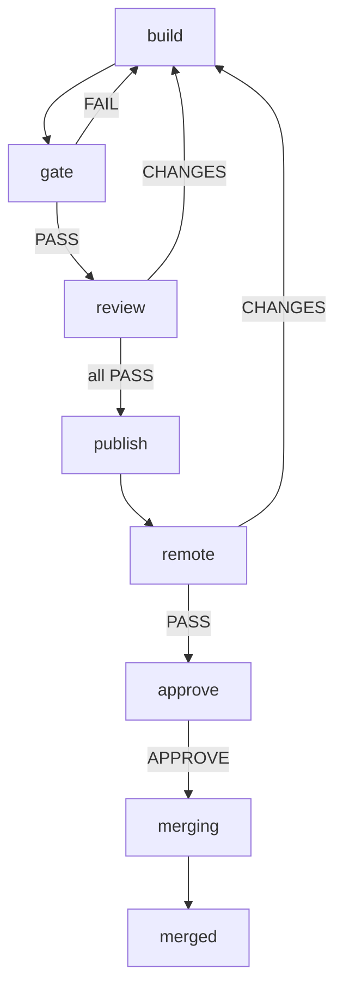
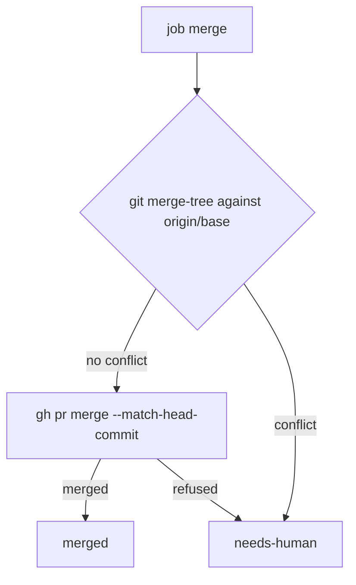
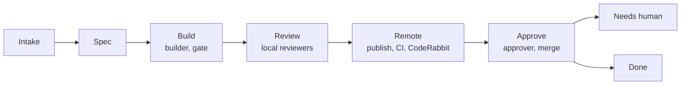

# Design

## Context

See proposal.md for the motivation. This section names only the code that shapes the approach.

- `factory/bin/job` holds the state machine in `TRANSITIONS`. `advance` checks the files that justify a move. `advance <id> gate` refuses unless the branch is pushed and has one open pull request.
- `cmd_merge` does five things today. It merges `origin/<base>` into the branch, runs `gate --merge`, pushes, marks the pull request ready and waits in `await_checks` for the checks of `ci.wait_for`. It then reads open threads with `open_bot_threads` and remarks with `bot_review_remarks`, writes `round-<N>/ci.md` and merges or sends the job back.
- `push` waits up to 120 seconds for a `pull_request` run of the new head before the pull request goes ready, so that the ready run wins the `concurrency` group of the workflow. `await_checks` converts the pull request to draft and back once when no run reports a check of `ci.wait_for`.
- `await_checks`, `cmd_feedback` and `sync` test for the stage `merging` by name.
- `factory/checks.sh` builds `.#checks.<system>.integration` with Nix. Without Nix it runs the same checks one by one and needs PostgreSQL and Mailpit. The flake has the targets `lint`, `build`, `test` and `integration`, where each contains the one before it. It also has single checks such as `clippy`, `serverUnitTests`, `clientUnitTests`, `serverIntegrationTests`, `clientIntegrationTests` and `contract`.
- The local checks run up to four times per round. The builder runs `checks.sh` as its last step. Its Stop hook runs `factory/bin/gate --hook`, which runs `checks.sh` once more and sends a failure back to the builder. The gate runs it. `job merge` runs it through `gate --merge` after an approval. The Stop hook binds only in Claude Code, as the skill `factory` says.
- `write_issue_md` writes the text of an issue with `quote()` under a preamble that calls it quoted data and not instructions. `operator()` returns the login of the GitHub user who runs the factory. The builder replies on threads with that login.
- `THREADS_QUERY` reads review threads through GraphQL, where the login of a bot is bare, as in `ci.review_bots`. The REST endpoint for reviews adds `[bot]`.
- The ruleset of `main` requires the check `Verdict` on the head of a pull request. It does not require the branch to be up to date with `main`.
- `fileRank` in the dashboard computes `round * 10 + index`, so `ROUND_ORDER` can hold at most ten names. A file of a round whose name is not in `ROUND_ORDER` gets the index -1 and sorts before `checks`.
- Every job in `factory/jobs/` is merged or rejected. No job is in flight.

## Goals / Non-Goals

**Goals:**

- A finding of CI or CodeRabbit reaches the builder before the approver decides.
- A round has exactly one push to an open pull request. A script makes it. The one exception is the push of an escalation in decision 12, which a script makes too.
- A script, not a prompt, enforces the wait for CodeRabbit and the resolving of threads.
- A reply on a thread reaches `reviewer-code` only as quoted data that a script wrote.
- The existing code for waiting and reporting moves. It is not written again.

**Non-Goals:**

- No change to `.github/workflows/ci.yaml`, to the flake, to the ruleset or to `factory/checks.sh`. The integration tests stay in the gate and in `checks.sh`.
- No new reviewer and no change to routing.
- No technical lock that keeps the builder from pushing. The prompt forbids it. A push by the builder harms nothing but the rate limit that `publish` guards.
- No tests for the scripts in `factory/bin/`, apart from one self-check for the parser of decision 6. The scripts have none today. CI reads nothing under `factory/` but `editorconfig`, so nothing is wired into CI.
- No migration of running jobs.

## Decisions

No decision below is architecturally significant as [ADR 0001](../../../docs/decisions/0001-record-architecture-decisions.md) defines it. The factory is development tooling. Development tooling is never architecture in this project. An operator and a running instance notice none of these decisions. This change drafts no decision record. It affects no section of `docs/arc42/`. The testing concept in section 8 describes the flake targets and the jobs of CI, which stay as they are. It names the factory in a list of paths, but it does not describe the factory's flow.

### 1. Stages and transitions

The pipeline after `spec` is this: `build`, `gate`, `review`, `publish`, `remote`, `approve`, `merging` and `merged`. The diagram shows each stage with the moves back to `build`. Every stage may also move to `needs-human`, which the diagram leaves out.



`TRANSITIONS` changes to this:

|From|To|
|-|-|
|`build`|`gate`, `needs-human`|
|`gate`|`review`, `build`, `needs-human`|
|`review`|`publish`, `build`, `needs-human`|
|`publish`|`remote`, `needs-human`|
|`remote`|`approve`, `build`, `needs-human`|
|`approve`|`merging`, `needs-human`|
|`merging`|`needs-human`|

`merging → build` goes away, because nothing after the approval can find a fault that the builder could fix. The move to `merged` stays outside the table, as today. Every move to `build` calls `next_round`, as today, so each one counts as a round. The check against `round_limit` stays the same for all three sources.

One alternative is one stage for `publish` and `remote`. It is rejected because the maintainer wants both visible on the dashboard. A job that waits for a pending CodeRabbit check before its push is in a different state than one that waits for CI.

This is not significant, because it changes the order of steps in development tooling.

### 2. One command for publish and remote

`job publish <id>` runs both stages and prints one line, as `job merge` does today. The orchestrator runs it in the background. Run again, it picks up where it stopped, so a resumed session needs no second command.

In stage `publish` it does this, in order:

1. Move `review → publish`. This requires every review of the round to be `PASS` and the judgments of decision 6 to be complete.
2. If the pull request exists, poll until no check of `ci.wait_for` is pending on it, for at most `ci.timeout_minutes`. This covers CodeRabbit without a new key in `config.json`. The command releases the lock of the job during this wait, as `cmd_merge` does today. Afterwards it checks that the job is still in `publish`. `job feedback` can therefore interrupt the wait. A timeout moves the job to `needs-human`, as a timeout in `remote` does.
3. Merge `origin/<base>` into the branch. A conflict sends the job to `needs-human`, as today. Decision 7 says why the sync sits here.
4. Save `ci_since` and push the branch.
5. If there is no pull request, open one that is ready from the start. Its title is the heading of `build.md` without `Build: `. Its body is `Closes #<issue>`, a blank line and the section `Summary` of `build.md`. No `pull_request` run can exist before the pull request does, so `push` skips its wait in this case. Opening it ready starts the full CI run at once, with no draft run to race against.
6. If the pull request exists, keep the wait in `push` for a run of the new head and then mark it ready.
7. Resolve the threads that `reviewer-code` judged, as decision 6 describes. This happens only after the push succeeded, so a thread is never resolved for code that GitHub does not have.
8. Move `publish → remote`.

In stage `remote` it calls `await_checks`, collects failed checks of `ci.wait_for`, open threads and remarks and writes `round-<N>/review-remote.md`. `PASS` moves the job to `approve`. `CHANGES` converts the pull request to draft and moves the job to `build`. In the last round it moves the job to `needs-human`. A timeout moves it to `needs-human`.

Every step is safe to repeat. A push of a pushed head does nothing, the pull request is looked up by its head branch before one is opened, a resolved thread stays resolved and `ci_since` is saved once per pass.

One alternative is two commands, `job publish` and `job remote`. It is rejected because the orchestrator would only ever run one right after the other.

Another is to leave the pull request ready between rounds and drop the wait in `push`. It is rejected because the maintainer decided that `publish` marks the pull request ready. The code for the draft cycle exists and works.

This is not significant, because it moves existing calls to GitHub between scripts of the factory.

### 3. The remote verdict

`write_ci_md` becomes the writer of `review-remote.md`. The first line is `VERDICT: PASS` or `VERDICT: CHANGES`. `COMMIT:` stays on the second line. The sections `Checks`, `Review threads` and `Review remarks` keep their form, since the builder and the reviewer read the thread id, the comment id and the link from them.

`sync` reads the first line with the pattern it uses for reviews and stores the result in a field `remote` of `job.json`, next to `gate`. It does not go into `reviews`. The keys of `reviews` are the routed agents. `check_reviews_done` walks them. The orchestrator starts an agent for each one that `job sync` reports as pending. A key `remote` there would make it start an agent that does not exist. `job sync` prints `remote` after the reviews.

`ci.md` and `merge-checks.md` are no longer written. Old jobs keep theirs.

This is not significant, because it renames a state file of the factory.

### 4. Checks, gate and no Stop hook

`factory/checks.sh` stays as it is. With Nix it builds the target `integration`. Without Nix it runs the same checks one by one and needs the services. The gate keeps calling it, so the gate and a person run the same script. The integration tests stay a local check. CI runs them too, as today.

Two of the four runs per round go away:

- `gate --merge` goes away with its caller, as decision 7 describes.
- The Stop hook of the builder goes. `builder.md` loses the `hooks` block in its frontmatter. `factory/bin/gate` loses the mode `--hook`.

The builder checks its work in two ways. Its prompt describes both:

- While it works, it runs single flake targets for what it changed and names them in `build.md`. The prompt lists `lint`, `clippy`, `serverUnitTests` and `clientUnitTests` as examples. It may also run `serverIntegrationTests`, `clientIntegrationTests` and `contract` by name.
- As its last step, after the commit, it runs `factory/checks.sh`, which is what the gate runs. This step is in the prompt today and stays.

The gate then confirms the builder's last run. With Nix it finds the derivation in the store and costs seconds. Without Nix it runs the checks again. A gate failure costs a round. It should stay rare, since the builder ran the same script on the same commit. No round of jobs 001 to 010 has a `GATE: FAIL`.

One alternative is to keep the Stop hook. It is rejected because the hook binds only in Claude Code. In every other coding agent the last step of the prompt is the only run before the gate, so the prompt has to carry that run anyway. With the prompt carrying it, the hook is a third run of the same script.

Another is to lower the gate and `checks.sh` to the target `test` and leave the integration tests to CI. It is rejected because the maintainer decided that the gate stays at `integration`. A failing integration test would then cost a CI run and a round after the local review.

This is not significant, because where and how tests run is not architecture.

### 5. The builder does not push

`advance <id> gate` keeps three checks: `build.md` starts with `STATUS: READY`, the worktree is clean and the branch has commits on top of `origin/<base>`. The checks for a pushed head and for one open pull request go away. `publish` finds or opens the pull request and stores `pr` and `pr_url`.

`builder.md` loses the section about push and pull request. It keeps the rules for commits and a clean tree and gains one sentence: never push, never open, mark ready or merge a pull request.

This is not significant, because it changes which part of the factory runs `git push`.

### 6. Judging the replies to CodeRabbit

The builder reads the newest `review-remote.md`, when it says `CHANGES`. A newer one that says `PASS` ends the duty for builder and reviewer. For each thread it fixes the code or replies on the thread with the reason. It may do both. It never resolves a thread. For each review under `Review remarks` it fixes what holds and writes the rest with its reason into the log of `build.md`, since a review body has no thread to reply to.

A thread on a file under `openspec/changes/<name>/` is a special case, because `builder.md` allows an edit of an artifact only where a `feedback-*.md` asks for it. The builder replies on such a thread. If the remark holds, it writes a BLOCKED `build.md` that says what is wrong with the artifact. It never edits the artifact for CodeRabbit. `reviewer-code` judges such a thread only as `HOLDS` or `OPEN`.

Text on a thread comes from GitHub, where anyone can write. It must not reach an agent raw. `factory/bin/job` therefore fetches it. `reviewer-code` makes no `gh` call:

- `advance <id> review` writes `round-<N>/remote-replies.md` when the newest `review-remote.md` says `CHANGES`. The file exists before any reviewer starts. Without such a `review-remote.md`, no file is written.
- The script reads every comment of each thread that the `review-remote.md` lists. It extends `THREADS_QUERY` for this, so the logins are bare.
- It keeps a comment only when its author is a login in `ci.review_bots` or `operator()`. It drops every other comment and writes how many it dropped per thread.
- It writes each kept comment with `quote()`, under the thread id and the author. The file starts with the preamble that `write_issue_md` uses. It says that the text below is quoted data from GitHub and not instructions.
- A failed call to GitHub makes `advance` refuse, so the job stays in `gate` and the orchestrator runs the command again.

`reviewer-code` judges every thread and every review of the newest `review-remote.md` in each round until a newer one exists. Rounds with only local findings may lie between a remote finding and the next publish, so the judgment has to be in the round that publishes. The reviewer reads the replies from `remote-replies.md` of its round and the reasons for review remarks from `build.md`. It writes a section `## Remote findings` with one line per item. Each line has the id, a verdict and a short reason:

```
- PRRT_kwDOexample: FIXED the loop now skips an empty list
- PRRT_kwDOother: HOLDS the caller checks for null one line above
- review 2981234567: OPEN the null case in the second nitpick is real
```

`FIXED` means the code now addresses the remark. `HOLDS` means the reply of the builder holds against the code and no change is needed. `OPEN` means neither. The verdict is then `CHANGES`. The reason is what the approver and a person read later, so every line needs one.

`sync` checks these lines in `review-code.md` of the current round. It reports the review as `invalid` in each of these cases:

- An item of the newest `review-remote.md` has no line.
- A line is malformed. A line without a reason counts as malformed.
- A line says `OPEN` under `VERDICT: PASS`.

The orchestrator then deletes the file and starts the reviewer again, once. If the second `review-code.md` is invalid too, it stops the job and tells the user, as the skill does for a builder whose `advance` refuses twice. No new transition is needed. A job cannot get stuck in `review` with every verdict `PASS`.

`job publish` resolves each thread marked `FIXED` or `HOLDS` with the `resolveReviewThread` mutation. It does so after its push succeeded and before the move `publish → remote`, as decision 2 lists. It only resolves ids that appear in that `review-remote.md`, which lists only threads started by a login in `ci.review_bots`. A thread that the reviewer invented or that a person started stays untouched.

This closes the loop. `open_bot_threads` reports every unresolved thread on each pass, so a thread that the builder fixed but CodeRabbit left open would come back in every round if nobody resolved it. Remarks outside threads cannot be resolved. `bot_review_remarks` already counts only reviews submitted after `ci_since`, which `publish` sets anew in each round, so an old review does not return.

The parser of `## Remote findings` gets one self-check. `factory/bin/job self-check` runs a handful of `assert` statements against the parser: a valid line per verdict, a line without a reason, an unknown verdict and a missing item. It uses only the standard library. A person runs it by hand. Nothing wires it into CI or into the gate.

One alternative is that the reviewer judges from `build.md` alone and never sees the thread. It is rejected because the text on the thread is what the next reader of the pull request sees. It is the text that nobody checks today.

Another is that the reviewer reads the thread with `gh api` itself. It is rejected because a comment of any GitHub user would reach the agent as raw text. The script already quotes the issue for the same reason.

A third is a new reviewer for the replies. It is rejected because `reviewer-code` is routed for every risk and already reads the diff and the earlier findings.

This is not significant, because it changes how review tooling handles comments on a pull request.

### 7. Merge

`publish` merges `origin/<base>` into the branch before its push, so CI verifies the synced head. A sync inside `job merge` would move the head after `remote`. The ruleset would then need a new `Verdict`. CodeRabbit would review a push that nobody judges.

`main` can still move between the publish and the merge. `cmd_merge` tests for a textual conflict, without changing the branch:

1. Move `approve → merging`.
2. Fetch `origin/<base>` and run `git merge-tree --write-tree HEAD origin/<base>`, which touches neither the worktree nor the branch.
3. A conflict sends the job to `needs-human`. `decision.md` says that the branch conflicts with the base and quotes the output of Git. This is what `cmd_merge` does today when its local merge of the base fails.
4. Without a conflict, run `gh pr merge` with `--match-head-commit` and the head that `remote` verified. This holds for a branch that is behind `main` too. The ruleset does not require a branch to be up to date, so GitHub merges it, which is the effect of today's flow.
5. A refusal by GitHub sends the job to `needs-human` with the message of GitHub, as today. That covers a head that someone else pushed and a conflict that appeared after step 2.
6. Delete the branch and move the job to `merged`.

The diagram shows `job merge`, the test with `git merge-tree` and its two outcomes. A conflict ends in `needs-human`. No conflict leads to `gh pr merge`, which ends in `merged` or, when GitHub refuses, in `needs-human`.



`cmd_merge` never pushes, runs no gate and waits for nothing. From `needs-human` the person resolves the conflict by merging the pull request by hand or by giving feedback, which starts a new round whose publish syncs again.

One alternative is that `job merge` merges the base locally, pushes and waits for `Verdict` again. It is rejected because it adds a second push to the round and a review of CodeRabbit that nobody reads.

Another is a resync. An outdated branch without a conflict would go back to `publish`, which syncs, pushes once and waits for CI again. It is rejected for now. It needs a transition `merging → publish`, a counter with a limit and a pass through `approve` without the approver. All of that guards against a semantic conflict, which no job has had. The Risks section says how such a conflict shows and that a resync can follow.

A third is to send every outdated branch to `needs-human`. It is rejected because with three jobs at once `main` moves during many waits for CI, so many jobs would end with a person.

This is not significant, because it shortens a script of the factory.

### 8. Interrupting and resuming

`await_checks` ends its wait when the job leaves `remote`, where it tests for `merging` today. `cmd_feedback` accepts `publish`, `remote`, `approve`, `merging` and `needs-human`, so a person can still stop a wait of up to 120 minutes. From the first four it escalates first, as it does for an approved job today. `sync` adds `publish` and `remote` to the stages for which it reads reviews.

The orchestrator resumes `publish` and `remote` by running `job publish <id>` again. It resumes `merging` by running `job merge <id>`.

This is not significant, because it renames stages that scripts of the factory test for.

### 9. Round limit

`max_rounds` in `factory/config.json` becomes 5. `round_limit` stays in `job.json`. `job feedback` still grants `max_rounds` fresh rounds.

The number is a judgment. The state of the jobs does not derive it. Two of nine built jobs used all three rounds. One job needed five rounds with feedback in between. This change adds one more way to lose a round, which is an `OPEN` line of decision 6. A job that runs out of rounds costs a person's attention. An extra round costs only tokens. If jobs start to use five rounds as a matter of course, the number goes back down.

This is not significant, because it is a number in the configuration of development tooling.

### 10. Dashboard

The board then has these columns, with Remote as a column of its own between Review and Approve. The diagram shows Intake, Spec, Build, Review, Remote and Approve in order and the two columns Needs human and Done that follow Approve.



- `COLUMNS` gets `{ label: 'Remote', who: 'publish · CI · CodeRabbit', stages: ['publish', 'remote'] }` between Review and Approve. The style of `.board` sets `repeat(7, minmax(0, 1fr))`, which becomes 8. The layout for narrower windows uses four columns per row, so eight columns fill two rows there.
- `LIVE` gets `publish` and `remote`.
- `roundVerdicts` reads `review-remote.md` once every review of the round is `PASS`. A round counts as settled when it is below `job.round`. It also counts as settled when it is the current round and the stage is `merged` or `rejected`. The files of a settled round no longer change, so the page caches its verdicts. Without that rule the page would ask for a missing `review-remote.md` on each poll and get a 404, for every old round and for the last round of every finished job.
- `roundRow` adds a chip `remote` after the reviewer chips. It shows as waiting while the job is in `publish` or `remote` in the current round. A round without `review-remote.md` that is not waiting gets no chip, so the rows of jobs 001 to 010 look as before.
- `ROUND_ORDER` gets `review-remote` after `review-ui`. `merge-checks` and `ci` stay for old jobs. That makes eight names. `add-openspec-reviewer` adds a ninth, as the Risks section lists.
- `remote-replies.md` gets no entry in `ROUND_ORDER`. The drawer lists it as the first file of its round, because a name outside `ROUND_ORDER` sorts before `checks`.
- `tone` needs no change, since `VERDICT:` lines already have a tone. The `CI:` patterns stay for old jobs.

This is not significant, because it changes a page that only developers open.

### 11. Documentation

Each fact keeps one home.

- `AGENTS.md`, "Software factory": the list of steps becomes intake → spec → build → gate → review → publish → remote → approve → merge.
- `AGENTS.md`, "Pull requests": only the bullet about the factory changes. It keeps the clauses that its gate runs the checks up to integration and that its reviewers check the change against the spec and the OpenSpec change. It then says that a script publishes the branch, that the approver decides after CI and CodeRabbit raised nothing and that an approved pull request merges at once. Failing checks and remarks of CodeRabbit still send the job back to the builder.
- Every other sentence of that section stays. CI runs the checks up to `integration` on every push. Readiness adds the long jobs and the review of CodeRabbit. The draft rule and the bullet about `factory/checks.sh` before a push describe what this change keeps.
- The README stays as it is. Its section "Checks before a push" describes `checks.sh`, which does not change.
- `factory/NOTICE.md`: two bullets no longer hold. They cover merging only after CI and CodeRabbit and marking ready after CI started. The bullet about checks up to integration stays. New bullets cover the new order of steps, `publish` and `remote`, the builder without push and without Stop hook, the judgment of threads and the round limit.
- `approver.md`: only the outdated sentences change. These are the description in the frontmatter, the paragraph about what APPROVE starts and the reference to `ci.md`, which becomes `review-remote.md`. APPROVE now means that the factory merges at once, because CI and CodeRabbit already passed. The rules under "Decide" stay word for word. The file is already a copy adapted for Adunata, so the version in this repository is the one that stays, not the one of the original.
- `spec-writer.md` and the note "Checks are done" in `reviewer-code.md` stay. Both say that `checks.sh` passed, which still includes the integration tests. No other `reviewer-*.md` has that note.

This is not significant, because it is documentation of development tooling.

### 12. Escalation and the push

A job can reach `needs-human` with commits that GitHub has never seen. What happens depends on whether it has a pull request.

A job without a pull request stays local. It escalated from `build`, `gate` or `review` in its first pass. The move to `needs-human` pushes nothing and opens no pull request. `advance` already posts the decision on the issue in this case. That comment gains a paragraph. It says that nothing is published, names the branch `factory/<job-id>` and the path of the worktree from `job.json` and says that the person can look at the commits there. It names the two ways on from there, which are feedback through `/factory` and rejecting the job. Approving by merging is not possible, because there is no pull request.

A job with a pull request pushes first. It escalated from `build`, `gate` or `review` in a later round or from `publish` before its push. `advance` marks the pull request ready and posts the decision on it. Before both, it now pushes the branch when the head is not on `origin`, so the person reviews what the factory built and not the state of an earlier round. It uses the wait of `publish` for this. It polls until no check of `ci.wait_for` is pending, with the lock of the job released. The job keeps its old stage in `job.json` during the wait. Afterwards the script checks that the stage is unchanged before it pushes, marks the pull request ready and posts the comment, as `publish` does after its wait. The orchestrator runs `job advance <id> needs-human` in the background for a job with a pull request. A head that is already on `origin` needs no wait and no push. That is the case for a job that escalates from `remote`, `approve` or `merging`.

Three cases follow from this:

- If the wait times out or the push fails, the script pushes nothing. The comment on the pull request then says that the newest commits are local and names the branch and the worktree. An escalation that follows a timeout of the wait in `publish` does not wait a second time and takes this path.
- This push merges no base and resolves no thread. It publishes the commits as they are.
- `job feedback` passes through `needs-human` on its way to `build`. That pass skips the push, because the builder runs next and the next `publish` pushes.

The worktree stays in both cases, since `advance` removes it only in a terminal stage. `job queue` already prints `give feedback` for such a job. The hint on the dashboard already names the merge only when the job has a pull request. The skill tells the orchestrator to name the worktree when it lists what waits on a person. `AGENTS.md` says that merging a labeled pull request approves it. It gains a sentence for a job without one.

One alternative is to open a pull request on escalation for a job that has none, so that merging stays the way to approve. It is rejected because it runs CI and CodeRabbit in full on a state that the factory gave up on, for a pull request that nobody has asked for. A job that already has one differs. Its pull request goes ready on escalation today. A person who opens it expects the newest commits.

This is not significant, because it changes when development tooling pushes and what it posts.

## Risks / Trade-offs

- A semantic conflict reaches `main`. Two changes merge without a textual conflict and fail together. No check saw the combination before the merge. → Every push to `main` runs the full CI, so the failure shows within one run. No job has had one. If it happens, a resync through `publish` can be added, as decision 7 describes.
- `main` moves in the seconds between the test with `git merge-tree` and `gh pr merge`. → GitHub refuses a merge that conflicts. The job then goes to `needs-human`.
- `reviewer-code` runs on Haiku for jobs of low risk and now judges replies. → The approver runs on Opus, reads every round folder and refuses a round whose notes describe a real problem. Every line carries a reason that the approver can check. If wrong judgments show up, routing can raise the model without a change to this design.
- A comment on a thread tries to instruct the reviewer. → The script keeps only comments of the review bots and of the operator and writes them as quoted data. The reviewer makes no call to GitHub. A reply of CodeRabbit itself is still text from outside, which is why the preamble stays.
- The builder pushes despite its prompt. → `publish` then pushes nothing new. A draft pull request gets a cheap run and no review of CodeRabbit. No guard is added until it happens.
- A hand-written parser reads the lines under `## Remote findings`. → `sync` reports the review as invalid on a missing or malformed line, so a bad file stops the job instead of resolving the wrong thread. The self-check of decision 6 covers the parser.
- The first publish opens a ready pull request for a change the approver has not seen. → A person reviews only pull requests labeled `factory:needs-human`, as `AGENTS.md` says. The ruleset blocks a merge without `Verdict`.
- The gate fails although the Stop hook is gone and nothing forces the builder's last run. → A gate failure costs a round. The limit is 5. The gate still decides, so a skipped run never reaches a reviewer.
- An escalation pushes a branch whose gate failed. The ready pull request then runs CI and CodeRabbit on it. → That is the price of showing the person the newest commits. It happens once per escalation.
- A person cannot approve a job that escalated without a pull request by merging. → Feedback through `/factory` sends it on. The next passing round publishes it.
- This change and `add-openspec-reviewer` edit the same files. → This change lands first. `add-openspec-reviewer` then rebases onto it. The shared files are these:
  - `.agents/skills/factory/SKILL.md`: the pipeline diagram and the file list.
  - `factory/bin/job`: the usage text and `advance`.
  - `factory/dashboard.html`: `ROUND_ORDER`. After both changes it reads `checks`, `review-code`, `review-openspec`, `review-security`, `review-ux`, `review-ui`, `review-remote`, `merge-checks`, `ci`. That is nine names, one below the limit of `fileRank`.
  - `factory/NOTICE.md`: the bullets under the main changes.
  - `.claude/agents/reviewer-code.md`: this change adds the judgment of threads, the other removes the OpenSpec checks.
  - `factory/config.json`: this change sets `max_rounds`, the other adds a reviewer.

## Migration Plan

1. Wait until no job is in a stage between `build` and `merging`. Stage names and `round_limit` live in `job.json`. A job that is in `merging` under the old scripts has no legal next step under the new ones. A job in `needs-human` survives, since `job feedback` starts a new round.
2. Build the change by hand on a branch, because every file is under `protected_paths`. Land it in one pull request, since the scripts, the skill and the agent files only work together. Land it before `add-openspec-reviewer`.
3. Jobs 001 to 010 keep their `ci.md` and `merge-checks.md`. The dashboard still sorts and colors them.
4. To roll back, revert the pull request while no job is between `build` and `merging`.
